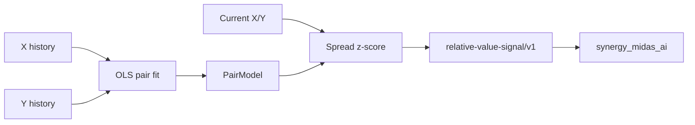

# ⚖️ SYNERGY Relative Value — verified technical dossier

> **Статус:** 🟡 CANDIDATE research producer.
> **Проверено по фактическому `main`:** 29.09.2026.

## 1. 🎯 Задача

Repository реализует компактные relative-value primitives:

- linear pair fit;
- spread z-score;
- carry score;
- synthetic path rate;
- federation relative-value signal.

Это research evidence producer, не autonomous trading strategy.

## 2. 📦 Фактический состав

В `main` есть Python package, enterprise API/auth/audit layer, tests, Docker/deploy/loadtests/docs/examples.

Core:

```text
src/synergy_relative_value/core.py
src/synergy_relative_value/synergy_contracts.py
```

## 3. 🧠 Pair model

Линейная модель:

[
y_t=alpha+eta x_t+epsilon_t
]

`fit_pair(x,y)` использует least squares и требует:

- aligned histories;
- одинаковую длину;
- минимум 10 observations.

Spread:

[
s_t=y_t-(alpha+eta x_t)
]

Хранятся:

- alpha;
- beta;
- spread mean;
- sample spread std.

Current z-score:

[
z=
rac{s_{now}-mu_s}{sigma_s}
]

Если spread std <=0, z-score принудительно 0.

## 4. 💹 Carry score

[
CarryScore=
rac{expectedCarryBps/10000}{volatility}
	imes clamp(corrHedge,0,1)
]

Если volatility <=0 → 0.

Это heuristic normalized carry score, не expected return estimate.

## 5. 🔗 Synthetic rate

Для path rates:

[
R_{synthetic}=prod_i r_i
]

Любой non-positive rate → reject.

## 6. 🏗️ Архитектура



## 7. Federation contract

```text
CONTRACT_ID = synergy.trading.relative-value-signal/v1
AUTHORITY   = relative_value_research
```

Payload включает:

- observation id;
- symbols;
- alpha/beta;
- spread mean/std;
- current zscore;
- `authorization=false`;
- `requires_domain_validation=true`.

## 8. 🛡️ Authority boundaries

```text
high |z| != guaranteed mean reversion
OLS relation != cointegration proof
historical beta != stable hedge ratio
carry score != realized carry
relative-value signal != execution authorization
```

## 9. ⚠️ Statistical limitations

Current core не проверяет:

- stationarity;
- cointegration;
- structural breaks;
- parameter uncertainty;
- half-life;
- residual autocorrelation;
- time-varying beta;
- costs/borrow/funding;
- asynchronous prices.

Поэтому pair z-score нужно считать feature/research signal.

## 10. 🧪 Required research gates

Перед использованием real capital:

1. aligned timestamps;
2. strict train/OOS separation;
3. Engle-Granger/Johansen or justified alternative;
4. spread stationarity;
5. rolling stability;
6. transaction costs;
7. borrow/funding;
8. liquidity;
9. stop/exit policy;
10. multiple-pair selection bias.

## 11. 📥 Inputs / 📤 Outputs

Inputs:

- observation id;
- x/y symbols;
- histories;
- current x/y.

Output: fitted relative-value state + z-score + explicit non-authorization flags.

## 12. 🧪 Required negative tests

- mismatched lengths;
- <10 observations;
- constant spread;
- sudden beta break;
- shuffled pair;
- missing data;
- large outlier;
- non-positive synthetic rates;
- volatility <=0 carry case;
- costs erase apparent edge.

## 13. 🛠️ Воспроизводимость

```bash
git clone https://github.com/Shtenco/synergy_relative_value.git
cd synergy_relative_value
python -m pip install -e .
pytest -q
```

## 14. 🗺️ Карта repository

| Path | Role |
|---|---|
| `src/.../core.py` | OLS/z-score/carry/synthetic rate |
| `src/.../synergy_contracts.py` | relative-value-signal/v1 |
| `src/.../api.py` | API |
| enterprise | auth/audit |
| tests | product/service/deploy/contracts |
| Docker/deploy/loadtests | operational scaffold |

## 15. 🔗 Место в SYNERGY

```text
relative-value research
→ relative-value-signal/v1
→ synergy_midas_ai
→ validation/risk/execution
```

## 16. 📊 Evidence maturity

| Layer | Status |
|---|---|
| OLS pair fit | ✅ |
| z-score | ✅ |
| typed signal | ✅ |
| enterprise scaffold | ✅ |
| cointegration proof | ❌ |
| historical OOS | ❌ |
| cost-adjusted alpha | ❌ |
| observed M4 E2E | ❌ |

## 17. 🚀 Roadmap

- timestamp provenance;
- stationarity/cointegration;
- rolling beta;
- half-life;
- cost model;
- OOS pair selection;
- portfolio-level neutralization;
- observed federation evidence.

## 18. 🛑 Что проект НЕ утверждает

- mean reversion is guaranteed;
- OLS = cointegration;
- z-score = trade;
- current beta is stable;
- source code proves live profitability.

## 19. 🔬 Cointegration is the central missing proof

The current OLS relation:

[
y_t=alpha+eta x_t+epsilon_t
]

can fit two trending unrelated price series and produce an apparently meaningful spread.

A production relative-value pipeline should explicitly test whether spread behavior supports mean reversion.

Minimum evidence:

- unit-root properties of raw series;
- residual stationarity;
- test statistic / critical values;
- training-only fit;
- OOS spread evolution;
- structural-break diagnostics.

## 20. ⏱️ Temporal alignment requirements

Pair data must be aligned by timestamp and market availability.

Unsafe examples:

```text
X close at 10:00
Y quote observed at 10:05
→ treated as simultaneous
```

or forward-filled illiquid prices creating synthetic stability.

Evidence should preserve:

```text
source
venue
timestamp
staleness
calendar
timezone
```

for both legs.

## 21. 💸 Full relative-value economics

A z-score is not P&L. A complete experiment must model:

[
PnL =
Delta Y
-etaDelta X
-Carry
-Borrow
-Fees
-Slippage
-Funding
]

with sign conventions appropriate to the actual long/short legs.

For FX/synthetic paths, rollover/swap and execution sequence matter.

## 22. 🧪 Falsification tests

A strong research suite should include:

- shuffled pairing;
- lagged fake partner;
- independent random walk;
- regime break injected into beta;
- spread variance explosion;
- cost ×2 / ×4;
- delayed leg execution;
- unavailable borrow;
- forced exit.

A strategy that only works on the original curated pair but fails basic null controls should not be promoted.

## 23. 📋 Evidence bundle

Store:

```text
observation_id
pair
train timestamps
fit alpha/beta
spread mean/std
stationarity test
current z
entry/exit thresholds
cost model
OOS outcome
software commit
authorization=false
```

## 24. ✅ Promotion gate

Before `relative-value-signal/v1` may be treated as validated research evidence, require strict OOS, stable pair diagnostics, costs and a QuantLab decision linked to the exact signal artifact.

---

[🧭 SYNERGY SYSTEM](https://github.com/Shtenco/synergy_system) · [📚 Atlas](https://github.com/Shtenco/synergy_system/blob/main/docs/SYNERGY_REPOSITORY_ATLAS.md)
