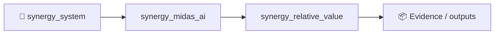
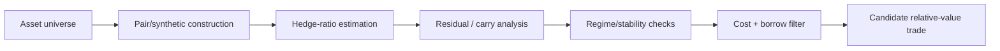

# SYNERGY Relative Value

> **Pairs, synthetic-cross, carry and market-neutral research engine**

Version: `2.0.0`

**Enterprise v2.0.0** · FastAPI/OpenAPI · Docker/Compose · RBAC/JWT · PostgreSQL/ClickHouse audit

**Designed for:** FX desks, macro funds, prop firms and systematic relative-value teams  
**Primary endpoint:** `POST /enterprise/v1/relative-value/analyze`

> [!IMPORTANT]
> Research infrastructure only. Pair relationships, z-scores and carry do not guarantee market-neutrality or profit.

## Verification
**20 tests passed** · health smoke **80/80 200** · local p95 **59.8 ms** (~652 req/s). Health smoke only.

## Quick start
```bash
pip install -e '.[dev,enterprise]'
pytest -q
python -m synergy_relative_value.api
```

## CTO package
[Due diligence](docs/CTO_DUE_DILIGENCE.md) · [Architecture](docs/ARCHITECTURE_DIAGRAMS.md) · [API](docs/API_EXAMPLES.md) · [Security](SECURITY.md) · [Benchmarks](docs/BENCHMARKS_AND_ACCEPTANCE.md) · [SLA/SLO](docs/SLA_SLO.md) · [Deployment](docs/DEPLOYMENT_CHECKLIST.md) · [Pilot](docs/CUSTOMER_PILOT.md)


<!-- SYNERGY-FEDERATION-PASSPORT:START -->
---

## 🧭 SYNERGY federation passport

**Домен:** ⚖️ Relative-value research  
**Архитектурный родитель:** [`synergy_midas_ai`](https://github.com/Shtenco/synergy_midas_ai)  
**Архитектурный корень:** [`synergy_system`](https://github.com/Shtenco/synergy_system)



Архитектурная стрелка — это карта федерации, а не автоматически подтверждённая runtime dependency.

### Единый стандарт

Каждый проект должен документировать реальную проблему, реализацию, тесты, evidence, ограничения, file map, воспроизводимость, roadmap и границы утверждений. Это тот же принцип, который используется в `dlp_solver`.

### Навигация

- [📚 Атлас всех 75 репозиториев](https://github.com/Shtenco/synergy_system/blob/main/docs/SYNERGY_REPOSITORY_ATLAS.md)
- [🧾 Машиночитаемый registry](https://github.com/Shtenco/synergy_system/blob/main/registry/SYNERGY_REPOSITORIES.json)
- [🧭 SYNERGY SYSTEM](https://github.com/Shtenco/synergy_system)

### Evidence rule

`GREEN` означает только воспроизводимо подтверждённый тезис. Гипотеза, benchmark без корректного протокола, архитектурная диаграмма или красивый экономический цикл сами по себе GREEN не дают.

<!-- SYNERGY-FEDERATION-PASSPORT:END -->
---

# ⚖️ Глубокая техническая спецификация Relative Value

## 🎯 Проблема

Низкий spread/z-score или историческая корреляция не доказывают стационарность, hedgeability или market-neutrality.

## 🏗️ Pipeline



## 📥 Входы

- price histories;
- carry/funding;
- contract specs;
- borrow/shortability;
- transaction costs;
- regime features;

## 📤 Выходы

- pair/synthetic definition;
- hedge ratio;
- residual/z-score;
- stability diagnostics;
- costed candidate;

## 🛡️ Непереговорные инварианты

```text
correlation != cointegration
historical beta != executable hedge
carry must include financing/borrow
market-neutral claim requires residual exposure check
OOS stability required
```

## 🧪 Как ловить ложный GREEN

- отделять API/health benchmark от качества торгового решения;
- проверять stale-state и timestamp binding;
- иметь negative/adversarial tests;
- не считать unit-test coverage доказательством инвестиционной ценности;
- сохранять request → decision → downstream evidence chain;
- явно указывать, что измерено локально, а что требует customer/live validation.

## 🔗 Контракт с соседями

- [`synergy_market_graph`](https://github.com/Shtenco/synergy_market_graph)
- [`synergy_quantlab`](https://github.com/Shtenco/synergy_quantlab)
- [`synergy_riskguard`](https://github.com/Shtenco/synergy_riskguard)
- [`synergy_midas_ai`](https://github.com/Shtenco/synergy_midas_ai)

## 🚀 Следующий доказательный рубеж

1. frozen acceptance dataset;
2. adversarial fixtures;
3. cross-module typed contract;
4. end-to-end trace id;
5. OOS/shadow evidence where market quality is claimed;
6. explicit failure-mode table;
7. reproducible evidence bundle referenced from README.
